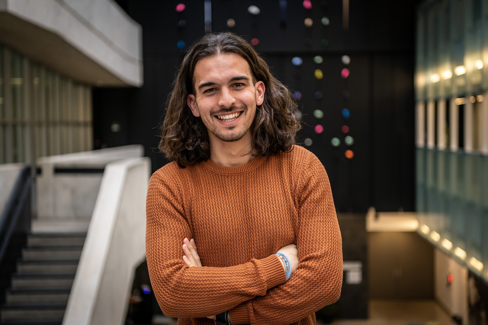

Website in progress, details to come!

Welcome to my webpage! My name is Sotiris Mygdalas\* (he/him) and I am currently a research assistant -- and a doctor-in-waiting -- at the Perimeter Institute for Theoretical Physics in Waterloo, Ontario, Canada. In August 2026, I defended my PhD in Physics at the University of Waterloo and the Perimeter Institute for Theoretical Physics, working with [Dr. Latham Boyle](https://www.ph.ed.ac.uk/people/latham-boyle) and [Prof. Niayesh Afshordi](https://nafshordi.com/). During my PhD, I was also a visiting PhD student at the Higgs Centre for Theoretical Physics at the University of Edinburgh (Scotland, United Kingdom), where my primary advisor Latham Boyle is located. Prior to this, I earned an MSc in Physics from the University of Waterloo after completing the [Perimeter Scholar's International (PSI) Master's Program](https://perimeterinstitute.ca/training/masters-program) (class of 2022); my PSI Essay's supervisor was Dr. Latham Boyle. Originally, I am from Serres, Greece, which led me to do my BSc in Physics at the Aristotle University of Thessaloniki (Greece); there, I worked with [Prof. Christos Tsagas](https://tsagas0.wixsite.com/mysite) for my BSc thesis, and I earned my degree in July 2021.  

\* If you receive an email from me and you are wondering "Does this person not know how to spell their name? I see Sotirios appearing in their signature and in my inbox, but they have signed off as Sotiris!" ... do not worry! My name is Greek, Σωτήριος Μυγδαλάς, (meaning, literally, Saviour (of) Almonds; its Spanish version, due to my friend [Cynthia](https://inspirehep.net/authors/3151960), is Salvador Almendra). Μany Greek male birth names end in "-ios". However, we Greeks consider these names way too formal to be used in every day life, so we decide to make them less formal by chopping the "-o-" from the ending, thus my name becomes Sotiris.

# Research Interests

## Spacetime Quasicrystals in Quantum Gravity

## Computational Complexity Theory and its Interplay with Gravity    

## The Mathematical Structure of the Standard Model of Particle Physics

